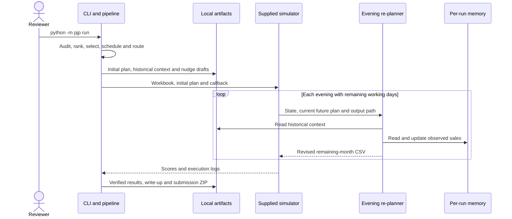

# 1005 PJP Planner

Turn dealer sales and visit history into a feasible November 2026 field-sales
plan, then adapt the remaining calendar to missed visits, sales changes and
weather forecasts. This local Python POC implements the five-stage assignment
for 1005 Intelligence Labs and packages its plans, evidence and practice results.


[Features](#core-features) · [Architecture](#architecture) ·
[Setup](#setup-and-installation) · [Usage](#usage) ·
[Results](#practice-results) · [Deliverables](#submission-deliverables)

## Core features

| Capability | Implementation |
| --- | --- |
| Explainable dealer ranking | Score all 677 dealers using value-weighted decline, supported drops, coarse GST peer context and scheme opportunity; export calculation evidence. |
| Constrained monthly planning | Select focus dealers and schedule 450 appointments across 75 officer-days, protecting club obligations and logging selection repairs. |
| Feasible daily routes | Exact small-route optimization with stated travel assumptions, service times and reserved demand-generation time. |
| Stateful evening re-planning | Accumulate observed sales, distinguish supported changes from noise, recover missed visits and apply forecast capacity/travel constraints. |
| Evidence-backed talking points | Generate 450 WhatsApp-style drafts under 300 characters, with 12 examples and the data behind each message. |
| Reproducible evaluation | Run the unmodified supplied simulator on practice seeds 1–3, verify outputs independently and build a concise private submission bundle. |

## Architecture

The full workflow prepares the initial plan, evaluates static and adaptive
policies, verifies their outputs and packages the results. The sequence below
shows the adaptive path; static evaluation omits the evening callback.



### Code layout

| Location | Responsibility |
| --- | --- |
| `src/pjp/__main__.py` | CLI argument parsing and command dispatch |
| `src/pjp/pipeline.py` | Complete workflow orchestration |
| `src/pjp/data.py`, `audit.py` | Input validation and workbook audit |
| `src/pjp/ranking.py`, `selection.py` | Commercial priorities and provisional focus selection |
| `src/pjp/planning.py`, `routing.py`, `travel.py` | Dated calendar, route ordering and travel arithmetic |
| `src/pjp/replanning.py` | Observation memory, sales signals and evening decisions |
| `src/pjp/nudges.py`, `reporting.py` | Draft messages, two-page report and private packaging |
| `src/pjp/evaluation.py`, `adaptive_evaluation.py` | Static/adaptive simulation and comparisons |
| `config/` | Explicit ranking, selection, scheduling, nudge and re-plan policies |
| `tests/`, `scripts/` | Synthetic tests and independent output verifiers |

## Setup and installation

The commands below are for macOS/Linux. If the repository is already cloned,
start at step 2.

### 1. Clone and check Python

You need Git and **Python 3.11 or newer**.

```bash
git clone https://github.com/Prem790/1005-pjp-planner.git
cd 1005-pjp-planner
python3 --version
```

Check the version before continuing. macOS Command Line Tools Python 3.9 is too
old. If needed, use an installed compatible interpreter such as `python3.12`
in the next environment-creation command.

### 2. Install in a virtual environment

```bash
python3 -m venv .venv
source .venv/bin/activate
python -m pip install -e .
python --version
```

For a named interpreter, substitute `python3.12 -m venv .venv` for the first line.
The final version check must show Python 3.11 or newer.

Dependencies are pinned in `pyproject.toml`: NumPy, pandas, openpyxl, ReportLab
and pypdf. Standard installation needs access to the Python package index;
execution uses local files. **No environment variables, API keys, database or
external map/LLM services are required.**

### 3. Place the supplied inputs

```bash
mkdir -p data/private
```

Copy the supplied workbook into `data/private/`. Extract the supplied simulator
ZIP and place its `PJP_Simulator` folder there. Check the exact nesting:

```text
data/private/
├── PJP_Assignment_Sample_Data.xlsx
└── PJP_Simulator/
    └── simulate.py
```

Only these two files are required at runtime. The simulator README and example
callback may remain alongside `simulate.py`; the assignment brief and video are
not runtime inputs. Use the original supplied files. Confidential inputs are
excluded from Git and the submission bundle.

## Usage

Run commands from the repository root with the environment active.

### Complete workflow — primary entry point

```bash
python -m pjp run
```

This performs nine stages: audit; rank; select; schedule/route; generate nudges;
static evaluation; adaptive evaluation; tests; submission packaging. A successful
run ends with `Full workflow completed ...` and records completion in
`artifacts/pipeline/run_summary.json`.

Allow a few minutes depending on the machine; the last verified run took about
75 seconds. Outputs are overwritten on repeat runs, and each practice simulation
starts with fresh memory. Unchanged inputs, configuration and software environment
produce the same main planning CSVs and scores; timings and PDF/ZIP metadata may
differ. The source workbook and simulator are not modified.

For inputs elsewhere, quote paths containing spaces:

```bash
python -m pjp run \
  --workbook /path/to/PJP_Assignment_Sample_Data.xlsx \
  --simulator /path/to/PJP_Simulator/simulate.py
```

In a new Terminal, enter your checkout and reactivate the environment:

```bash
cd /path/to/1005-pjp-planner
source .venv/bin/activate
python -m pjp run
```

Replace `/path/to/1005-pjp-planner` with your checkout location. Environment
creation and dependency installation are not required on every run.

### Evaluate against the supplied or reviewers' simulator

First complete the full workflow above. It creates the combined initial plan
and `artifacts/replanning/context.json`, the cached historical inputs needed by
the evening callback.

```bash
python data/private/PJP_Simulator/simulate.py \
  --workbook data/private/PJP_Assignment_Sample_Data.xlsx \
  --plan artifacts/plan/plan_november.csv \
  --replan-cmd "python -m pjp replan" \
  --seed 1 \
  --out artifacts/simulation/reviewer_run
```

Reviewers can substitute their simulator/workbook paths and an unpublished seed.
The re-planner receives neither the seed nor hidden event labels.

**Configure `python -m pjp replan` as the callback.** The simulator appends the
actual `--state`, `--plan` and `--out` arguments every evening. The complete
`run` workflow is not the per-evening callback.

The expanded interface is:

```bash
python -m pjp replan \
  --state STATE.json \
  --plan CURRENT_PLAN.csv \
  --out NEXT_PLAN.csv
```

Uppercase filenames are placeholders supplied by the simulator, not files to run
literally. The command writes the complete remaining-month plan, including the
required `date, so_id, sequence, account_id, account_type` columns plus timing
and reasons. Output is written atomically.

The default context path is relative to the repository root. If the simulator
runs from another directory, install this package in its Python environment
and include `--context /absolute/path/to/context.json` in the callback string.

### State and memory

The evening state supplies observed sales, visit outcomes, completed visits
month-to-date, next-day forecasts and rules. Memory defaults to `pjp_memory.json`
beside the simulator-provided current plan. Separate simulator temporary
directories isolate runs while retaining observations between evenings.

Use `--memory /path/to/run/memory.json` for explicit persistent state, with a
fresh path for each independent run. Decision logs save signals, changed visits,
unplaced obligations and the full future plan. Hidden event files are used only
by post-run evaluation/verification, never by the planner.

### Individual stages

```bash
python -m pjp audit --workbook data/private/PJP_Assignment_Sample_Data.xlsx
python -m pjp rank --workbook data/private/PJP_Assignment_Sample_Data.xlsx
python -m pjp select --workbook data/private/PJP_Assignment_Sample_Data.xlsx
python -m pjp plan --workbook data/private/PJP_Assignment_Sample_Data.xlsx
python -m pjp nudge
python -m pjp evaluate-static
python -m pjp evaluate-adaptive --seeds 1 2 3
```

Stages consume earlier outputs. Use the complete workflow first, especially
before adaptive evaluation, and after changing policies or source data.

## Practice results

The same initial plan is used for both policies. Means across published practice
seeds 1, 2 and 3:

| Metric | Static | Adaptive |
| --- | ---: | ---: |
| Simulated adherence | 94.52% | 97.14% |
| Focus-dealer coverage | 94.41% | 89.83% |
| Club cadence | 80.25% | 100.00% |
| Drops visited within seven days | 19.70% | 62.37% |
| Original-date adherence | 94.52% | 69.63% |
| Completed visits per run | 425.3 | 407.0 |
| Guardrail breaches | 0 | 0 |
| Re-plan failures | Not invoked | 0 |

**The coverage trade-off matters.** Adaptation protects club cadence and improves
drop response, but focus coverage and completed-call volume fall. Forecast
false alarms reserve five-call days even when actual weather is clear. With a
full initial calendar, recovery priorities consume scarce capacity. Higher
adherence partly reflects fewer scheduled visits; moving an appointment also
reduces original-date adherence even if it is completed later.

All 72 adaptive evening calls completed without failures or timeouts in these
practice runs. These results do not establish unpublished-seed performance.
The approximate 60% historical manual benchmark is contextual, not a simulated
control, and no causal real-world uplift or unofficial combined score is claimed.

## Submission deliverables

The complete workflow produces `artifacts/submission_bundle.zip`. Its ten files
use one format per deliverable:

```text
artifacts/submission/
├── READ_ME.txt
├── approach_and_results.pdf
├── plan_SO-A.csv
├── plan_SO-B.csv
├── plan_SO-C.csv
├── practice_seed_1/summary.json
├── practice_seed_2/summary.json
├── practice_seed_3/summary.json
├── simulator_comparison.txt
└── whatsapp_nudges_with_evidence.txt
```

The three CSVs each contain 150 initial appointments and the required date,
officer, sequence, account, arrival, travel and reason fields. The PDF is exactly
two pages; the nudge text contains 12 examples with supporting data.

Keep the repository for code/documentation and send the confidential ZIP privately
to reviewers. The workbook, supplied simulator and source documents are excluded.
Detailed CSVs, static summaries, repair logs and verification remain outside the
bundle. Editable report text is in `artifacts/reports/`; package checksums are in
`artifacts/submission_manifest.json`. No messages or uploads happen automatically.

### Internal output locations

| Directory | Contents |
| --- | --- |
| `artifacts/audit/` | Workbook checks and historical guardrail flags |
| `artifacts/ranking/` | Scores, owner/scheme evidence and sensitivity |
| `artifacts/focus/` | Provisional selection and deferral reasons |
| `artifacts/plan/` | Initial CSVs, daily budgets, final focus and explicit repairs |
| `artifacts/nudges/` | All 450 drafts, examples and evidence |
| `artifacts/replanning/` | Cached historical context |
| `artifacts/simulation/static/` | Fixed-plan practice logs and scores |
| `artifacts/simulation/adaptive/` | Adaptive memory, decisions, scores and comparison |
| `artifacts/pipeline/` | Verification logs and completion record |

The combined 450-appointment simulator input is
`artifacts/plan/plan_november.csv`, outside the concise reviewer bundle.

## Verification

```bash
python -W error -m unittest discover -s tests -v
python scripts/verify_rankings.py --workbook data/private/PJP_Assignment_Sample_Data.xlsx
python scripts/verify_focus.py --workbook data/private/PJP_Assignment_Sample_Data.xlsx
python scripts/verify_plan.py --workbook data/private/PJP_Assignment_Sample_Data.xlsx
python scripts/verify_nudges.py --workbook data/private/PJP_Assignment_Sample_Data.xlsx
python scripts/verify_adaptive.py
```

The complete workflow runs these automatically and stops if a check fails.
The last verified suite has 64 synthetic tests. Independent verifiers use
separate arithmetic/source-reading paths to reconcile ledger features, messages,
initial routes, scores and every evening's full future plan. They check ownership,
frequency, club spacing and forecast travel budgets. Source inputs are hashed
before and after the workflow. Packaging requires successful verification records.

## Assumptions and limitations

- Six initial visits on each of 25 working days gives 150 appointments per SO.
  Protecting clubs yields 142/132/149 distinct focus dealers, above the brief's
  approximate 100. Two remote non-club replacements are explicitly logged.
- Ranking weights are 55% value loss, 30% supported drops, 10% coarse GST peer
  context and 5% scheme opportunity. These are explicit baseline choices.
- Sales-change detection compares 3–5 observed working days with historical
  signed sheets/workday, using approximate overdispersed count evidence.
  Extra repeat visits need stronger evidence; low-volume changes remain difficult.
- Travel follows the simulator: Haversine x 1.35, 18/30 km/h, 25-minute dealer
  service, and no return leg. Unknown GPS uses fixed 25/45-minute travel without
  moving the known position; modeled feasibility is not proof of real travel time.
- The supplied simulator reserves two 40-minute DG calls including travel.
  Initial DG blocks are 17:10–17:50 and 17:50–18:30. No DG account identities are
  invented. A separate lunch duration is not specified and is not subtracted.
- Explicit membership determines club obligations. Shared owners share scheme
  points; reused quarterly targets are labeled assumptions. Broad GST proxies
  do not establish exact turnover or wallet share.
- Nudges are drafts from the October 15 snapshot, not live November messages.
  They should be refreshed after observations and re-planning in a live system.
- Forecast errors and late misses can prevent full recovery. Shortfalls are
  logged; real deployment needs verified GPS, availability, opening hours,
  travel times and calibrated business costs for coverage versus intervention.

## Troubleshooting

| Symptom | Action |
| --- | --- |
| `No module named pjp` | Activate `.venv`, then run `python -m pip install -e .` from the repository root. |
| Python below 3.11 | Create the environment using a compatible interpreter, such as `python3.12`. |
| Missing workbook or simulator | Check exact filenames and the input folder nesting under Setup. |
| Missing historical context | Complete `python -m pjp run` before adaptive evaluation or the evening callback. |
| Cannot find `STATE.json` | The uppercase names are placeholders; let the simulator supply the actual files. |
| Verification failure | Inspect `artifacts/pipeline/` logs and the failing stage before submission. |

## Further documentation

- [Ranking rules](docs/ranking_rules.txt)
- [Focus selection](docs/focus_selection_rules.txt)
- [Calendar and routes](docs/calendar_and_routes.txt)
- [Nudge evidence](docs/visit_nudges.txt)
- [Static evaluation](docs/static_evaluation.txt)
- [Re-planning and results](docs/replanning_and_results.txt)
- [Confidential data handling](docs/data_handling.md)

Keep confidential inputs and generated results out of Git and public issues.
Delete assignment copies after the process as instructed when authorized;
no deletion is automatic.
